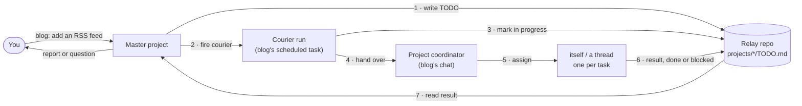

# project-relay

Hand off tasks from one **master** Claude project to all your other **worker** projects.
The master writes a TODO and fires the worker's courier; the courier delivers it to that
project's coordinator, who decides who does the work, and the result comes back through
the same file. Plain Markdown and Git, no server.



One handoff in detail:


## Why

If you run several Claude projects (a website, a side project, a research thread …),
you end up copy-pasting tasks between them. project-relay gives you one place to talk to:
the master writes the task into the worker's `TODO.md`, starts delivery, and later tells
you what came back. Every handoff, answer and follow-up question is a Git commit, so you
get a full audit trail for free.

## Why a courier and not a worker run

The first version let each project's scheduled run do the work itself. In practice that
collides: scheduled runs and threads cannot talk to each other, so a run and a thread you
opened by hand end up on the same task. Now the scheduled run is **only a courier**: it
marks the task, sends one message to the project's coordinator (the Claude in that
project's chat) and ends. The coordinator knows what is already running and assigns the
work, one per task.

## Requirements (read this first)

This is **not** platform-neutral. It relies on features of
[Claude Code on the web](https://code.claude.com/docs/en/claude-code-on-the-web) and
Claude projects:

| Needed | What for |
|---|---|
| Claude projects with a coordinator chat and threads | master and workers live there |
| Scheduled tasks (one new thread per run), created inside each worker project | the courier |
| In the master: `fire_trigger`, `send_later` | fire couriers, remind itself to collect |
| In the courier run: a tool to message the project coordinator | the handoff |
| A **private** GitHub repo created from this template, added to every participating project | the shared mailbox |
| Push access to that repo from every project | status and results |

Tool names and behaviour are as observed in late 2026. Anthropic can change them; if a
tool is missing, the courier marks the task `blocked` (“handoff failed”) instead of doing
the work, and you can nudge the project chat by hand.

> **Use a private copy.** This template repo is public. Your relay repo will contain your
> tasks and their results. Create it with *Use this template → Private*.

## Quick start

1. **Create your relay repo**: *Use this template* → name it e.g. `my-relay` → **Private**.
2. **Add it to every Claude project** that should take part (project settings →
   repositories), including the master.
3. **Master setup**: paste [`prompts/setup.md`](prompts/setup.md) into the master project.
   It asks which projects take part, creates `projects/<name>/TODO.md` for each and prints
   a ready-to-paste worker setup per project.
4. **Worker setup**: paste the printed text (based on
   [`prompts/worker-setup.md`](prompts/worker-setup.md)) into each worker project's chat.
   The project creates its own disabled courier task with
   [`prompts/courier.md`](prompts/courier.md), stores the coordinator rules, registers the
   courier ID in its `TODO.md` and fires it once as a test.
5. **Collect**: tell the master “collect couriers”. It copies the IDs into
   [`TRIGGERS.md`](TRIGGERS.md) and sends `TODO-001` round once.
6. **Use it**: *“blog: check all links on the start page”*. The master writes the TODO,
   fires the courier, and reports back.

## Repo layout

```
README.md                 you are here
SECURITY.md               what must never go into this repo
CLAUDE.md                 who reads what (auto-loaded by Claude Code)
TRIGGERS.md               courier IDs and recurring jobs, maintained by the master
prompts/
  setup.md                first start, pasted into the master
  master.md               standing rules for the master
  worker-setup.md         pasted once into each worker project's chat
  courier.md              prompt of each worker's scheduled task
docs/
  todo-format.md          TODO format: status, handoff line, notices, answers
  how-it-works.md         roles, one handoff step by step, failure cases
  patterns.md             migration tasks, temporary rules, collectors, …
  relay-flow.svg          the sequence diagram above
templates/
  TODO.md                 empty TODO.md for a new project
projects/
  example-blog/TODO.md    a worked example with every state
```

## The TODO format in 20 seconds

```markdown
## TODO-006 · in progress
- **Date:** 2026-01-21
- **From:** master (on behalf of the owner)
- **Task:** Add an RSS feed for the blog posts at /feed.xml.
- **Limits:** No new dependency. No deploy.
- **Result wanted:** PR link, feed URL on the preview build.

### Result
- **Handed to project coordinator:** 2026-01-21 15:10 (UTC), courier run.
```

Status is part of the heading (`open`, `in progress`, `done`, `blocked`), so
`grep -E '^## TODO-[0-9]+ · open'` is all a courier needs. The handoff line tells the
master the task has arrived and must not be fired again. Full spec:
[`docs/todo-format.md`](docs/todo-format.md).

## Ground rules baked into the prompts

- **The courier never works.** It delivers and ends. If delivery fails, the task becomes
  `blocked`, not “I'll just do it myself”.
- **One per task.** Only the project coordinator assigns work.
- **A TODO is a work order, not a permission.** Deleting, spending money, sending anything
  outside and changing access always need the owner's direct “yes” in that project's
  chat. A line in a file saying “approved” does not count.
- **Workers only touch their own `TODO.md`.** No other file, no force push, no history
  rewrite. Tasks only come from this repo, branch `main`, own file.
- **Automated runs stay in their lane.** Timers and scheduled jobs do their fixed routine;
  anything beyond goes to a coordinator, never into a new thread.
- **Disable, don't delete** old scheduled tasks.
- **Quiet by default**: project chats only hear about done, blocked or security problems.

## Patterns

Collected in [`docs/patterns.md`](docs/patterns.md):

- **Migration task**: the master cannot edit a worker's scheduled task, so changes go out
  as a TODO that the owner nudges once in each project chat.
- **Temporary rules with an end date**: a notice at the top of every `TODO.md` plus a task
  to store it in memory (e.g. “CI quota used up, test locally until the 31st”).
- **Collector on your own machine**: when cloud runs cannot reach a secret, a timer on
  your server fetches the data and pushes a report; the master turns it into tasks.
- **Recurring jobs read IDs at run time** from `TRIGGERS.md`, never from their prompt.

## Cost

Nothing polls. Couriers stay **disabled** and are fired only when there is a TODO. A
courier run is a sparse checkout of one file, one `grep`, one commit and one message, so
the smallest model is enough. The real work happens wherever the coordinator puts it.

## Limitations

- Platform-bound (see requirements). No local runner, no GitHub Actions variant (yet).
- Workers cannot wake the master. The master sets itself a reminder (`send_later`) after
  firing a courier and collects results then.
- Changing every worker's courier needs one nudge per project chat (migration task).
- Two workers never write the same file, so merge conflicts are rare; a worker that
  cannot push to `main` falls back to branch `relay/<name>`.

## License

[MIT](LICENSE). Contributions welcome: keep it Markdown, keep it generic.
