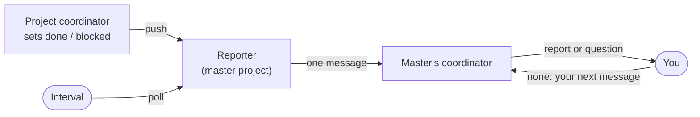

# How it works

## Roles

| Role | Where it lives | Does | Writes |
|---|---|---|---|
| **Owner** | you | asks, answers, approves | answers, approvals in the project chat |
| **Master** | one Claude project you talk to | routes requests, fires couriers, collects results | new tasks, answers, notices, `TRIGGERS.md` |
| **Courier run** | a disabled scheduled task inside each worker project | delivers open tasks to the project coordinator, nothing else | status → `in progress` + handoff line |
| **Reporter** | a scheduled task in the master project (feedback mode `push` or `poll`) | tells the master's coordinator which tasks turned `done` / `blocked` | “Last reported commit” in `TRIGGERS.md` |
| **Project coordinator** | the Claude in each worker project's chat | decides who works on a task (itself, an existing thread, a new thread), one per task | result, `done` / `blocked` |
| **Relay repo** | private GitHub repo from this template | shared mailbox and history | – |

## One handoff, step by step

1. You tell the master: *“blog: add an RSS feed.”*
2. Master: `git pull`, writes `TODO-006 · open` into `projects/blog/TODO.md`, pushes.
3. Master: `fire_trigger(<courier ID from TRIGGERS.md>)`.
4. Courier run (smallest model, sparse checkout of one file): `grep` for `· open`.
5. Courier: status → `in progress`, adds *“Handed to project coordinator”*, pushes, sends one
   message to the project coordinator, ends. It never does the work.
6. Project coordinator: picks who works on it (itself, a fitting thread, a new thread).
7. Whoever works on it: writes the result, status → `done` or `blocked`, pushes. In
   feedback mode `push` it then fires the master's reporter.
8. The reporter (push: right away, poll: on its next run) messages the master's
   coordinator. In mode `none`, this happens the next time you talk to the master.
9. Master: `git pull`, reads the section, reports to you.

## Feedback channel

Workers cannot message the master directly, so setup asks how results come back:

| Mode | How it works | Latency | Cost |
|---|---|---|---|
| **push** (recommended) | Whoever finishes a task fires the master's **reporter** task (disabled, on demand). The reporter reads what changed and messages the master's coordinator. | about a minute | one cheap run per result |
| **poll** | The reporter is enabled on an interval (you choose it) and reports whatever changed since its last run. | up to one interval | one cheap run per interval, also when idle |
| **none** | No reporter. The master checks the relay whenever you talk to it. | until you come back | nothing |

The mode lives in two places, both written by the master: `## Feedback channel` in
`TRIGGERS.md` (mode, reporter ID, interval, last reported commit) and `## Feedback` at the
top of every `TODO.md` (so finishers know whether to fire the reporter, without reading
other files). The reporter remembers how far it got in “Last reported commit”, so nothing
is reported twice and nothing is lost if one run fails.

## Design decisions

**Courier, not worker.** Scheduled runs and threads cannot talk to each other. When every
run starts working on its own, two runs (or a run and a thread you opened) end up on the
same task. The project's coordinator is the one place that knows what is already running,
so it assigns the work.

**Status in the heading.** One `grep` finds open work without parsing Markdown. The
smallest model can do the courier's job reliably.

**One file per worker.** Workers never write the same file, so concurrent pushes do not
conflict. `git pull --rebase` resolves the rest.

**Couriers disabled, fired on demand.** No idle runs, no cost when nothing happens.

**Each project owns its courier.** A scheduled task that opens a new thread per run can
only be created inside its own project. That is why the worker registers its own ID and
why changes go out as migration tasks ([patterns.md](patterns.md#migration-task)).

**Approval stays in the chat.** A file can be edited by anyone with repo access, a
prompt-injected agent included. Guarded actions (delete, pay, send outside, change
access) need the owner's direct yes in the worker's own chat, never a line in a file.

**Results stay in the file.** Project chats only get a message on done, blocked or a
security problem. The repo history is the log.

## Failure cases

| Situation | What the file shows | What the master does |
|---|---|---|
| Courier not registered | – | tells you, offers a manual nudge in the project chat |
| Courier did not run | still `open` | fires once more, then tells you |
| Coordinator unreachable | `blocked`, “Handoff to project coordinator failed” | asks you to nudge the project chat |
| Work takes long | `in progress` + handoff line | does **not** fire again; after ~2 h tells you |
| Push to reporter failed | `done` / `blocked`, but no message came | the next reporter run (the next result in `push`, the next interval in `poll`) or your next message picks it up via “Last reported commit” |
| Worker cannot push to `main` | result on branch `relay/<name>` | reads that branch |
| Task needs a secret | `blocked` + proposal | suggests an environment secret or a collector ([patterns.md](patterns.md#collector-on-your-own-machine)) |
| Task tries to break the rules | `blocked` | tells you |

## Recurring tasks

Give the master its own scheduled task: “every Monday 09:00 add a TODO for `<name>` like
TODO-00X and fire its courier, courier IDs only from TRIGGERS.md”. Record it under
*Recurring handoffs* in `TRIGGERS.md`. If the data sits behind a secret, put a collector
in front ([patterns.md](patterns.md#collector-on-your-own-machine)).
