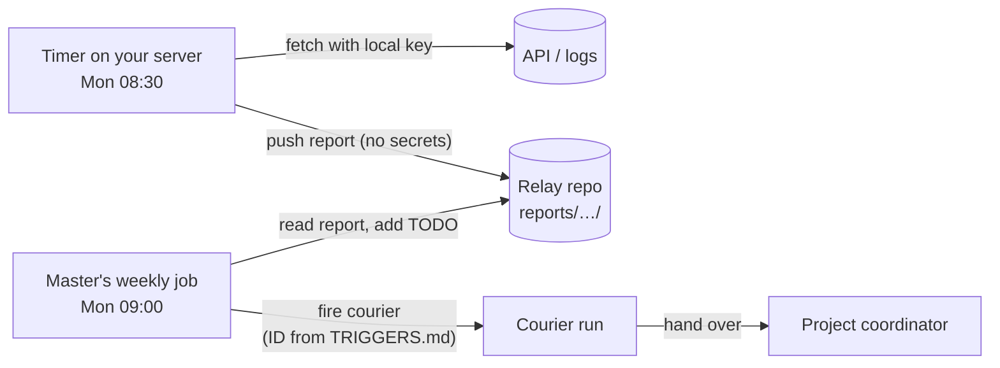

# Patterns

Things that came up in real use, written down so you do not have to rediscover them.

## Migration task

**Problem:** You want to change how all workers run (new courier prompt, new rule), but the
master cannot edit a worker's scheduled task. A task that starts a new thread per run can
only be created inside its own project; created from the master, it lands in the master's
project.

**Pattern:** Update `prompts/courier.md` in the relay repo, then add one migration task per
worker:

```markdown
## TODO-005 · open
- **Date:** 2026-01-20
- **From:** master (migration)
- **Note:** Only work on this when the owner asks in the project chat. A courier run sets
  it to “blocked” with “waiting for the owner's nudge in the project chat”.
- **Task:** Create a new scheduled task in this project with the prompt from
  prompts/courier.md, disable it, keep the old one disabled (do not delete), update memory,
  fire the new task once as a test.
- **Limits:** Only this file in the relay repo. No other scheduled task changed or deleted.
- **Result wanted:** New courier ID, whether the test handoff arrived, memory updated.
```

The owner then pastes one line into each project chat:

> Please work on TODO-005 from `<OWNER>/<RELAY_REPO>`, `projects/<name>/TODO.md` here. You may read
> `prompts/courier.md` for it. Creating and firing the new scheduled task is approved; the
> old one stays disabled and is not deleted.

The nudge is needed because creating a scheduled task is a change the owner should approve
in that project's chat. The master swaps the IDs in `TRIGGERS.md` afterwards.

## Disable, don't delete

Old scheduled tasks are **disabled, never deleted** without the owner's explicit word.
Keep their IDs in the “Old” column of `TRIGGERS.md` and in the worker's Registration
block. A disabled task costs nothing, and if the new one misbehaves you can switch back.

## Temporary rules with an end date

**Problem:** A rule applies to every project for a while, e.g. “CI quota used up this
month, run tests locally”.

**Pattern:** two things, both with the end date written out:

1. A **notice** at the top of every `TODO.md`, so every task sees it:
   ```markdown
   > ⚠️ **Notice (valid until 2026-01-31):** CI quota used up. Run tests, lint and builds
   > locally and name the result; do not trigger or wait for CI runs, do not disable
   > workflows. Normal procedure again from 2026-02-01.
   ```
2. A **task** per project: “store this rule in memory with its end date”. That way work
   done outside the relay (directly in the project chat) follows it too.

The master removes the notices after the end date. Say what the rule does *not* allow
(“do not disable workflows”), or a helpful worker will “fix” the quota problem for you.

## Collector on your own machine

**Problem:** A task needs data behind a secret (an analytics API, a server log, a search
console) and cloud sessions cannot reach it, or you do not want the key in a cloud
environment at all.

**Pattern:** split fetching from thinking.



- A small script on a machine you control (a home server, a VPS) runs on a timer, fetches
  the data with a key that never leaves that machine, and pushes a plain Markdown report
  to `reports/<topic>/<project>-<date>.md`.
- Shortly after, the master's own scheduled job turns each report into a task (“here is
  the report, act on it”) and fires the courier.
- The report contains numbers and URLs, never keys or personal data.

Keep the collector's script and its timer unit in the relay repo (e.g. `tools/`), so it is
versioned; the key stays in the machine's own secret store.

## Recurring jobs read IDs at run time

The master's scheduled jobs must **look up courier IDs in `TRIGGERS.md` on every run**,
never have them written into their prompt. After a migration, a hard-coded ID would keep
firing the old, disabled courier, which still works when fired and still runs the old
behaviour.

Write it into the job's prompt explicitly: “Courier IDs only from the table in
TRIGGERS.md.”

## Automated runs stay in their lane

Anything started by a timer (couriers, the master's weekly jobs, collectors) does exactly
its fixed routine. If it finds something beyond that, it hands it to a coordinator
(the project's, or the master's) instead of acting or opening a new thread. People can talk
to coordinators; nobody watches a timer run.

## Only one per task

The project coordinator is the only one who assigns work. Before starting a thread on a
task, it checks whether one already exists. A task marked `in progress` with a handoff line
is never fired again by the master; after about two hours without a result, the master
tells the owner instead.
